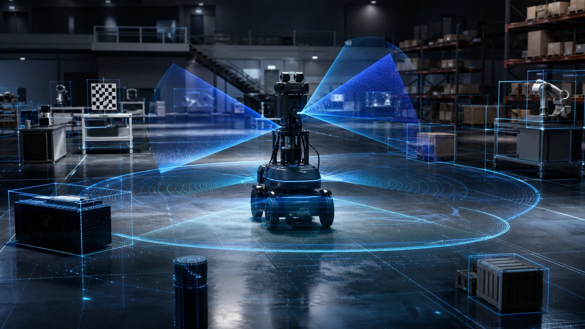

## 버전부터 결정하기

2026-10-23 확인 기준 신규 설치 경로는 **Isaac Sim 6.2 + Python 3.12**입니다. Isaac Lab 3.0의 Isaac Sim 백엔드도 6.2를 대상으로 합니다. 기존 이 코스의 `World`·Articulation 실습은 **Isaac Sim 5.1 + Isaac Lab 2.3.2** 재현 경로로 구분합니다. 5.1 공식 문서는 현재 지원 종료를 표시하므로, 이 경로를 신규 운영 환경의 권장 버전으로 해석하지 마세요.

| 목적 | 버전 범위 | 주의점 |
|---|---|---|
| 신규 시뮬레이션 개발 | Isaac Sim 6.2, Python 3.12 | Core Experimental API 마이그레이션 필요 |
| 기존 2.x 예제 재현 | Isaac Sim 5.1, Python 3.11, Isaac Lab 2.3.2 | 별도 가상환경 사용, 지원 종료 상태 확인 |
| Isaac Lab 3.0의 Newton 학습 | Isaac Lab 3.0, Python 3.12 | Isaac Sim 설치가 필수는 아님 |

Omniverse Launcher와 Nucleus Workstation은 **2025-10-01 지원이 종료**되었습니다. 새 환경은 공식 바이너리, Python 패키지, NGC 컨테이너 경로로 설치합니다. 로컬 USD 파일 실습에 Nucleus 서버는 필요하지 않습니다.

## 시스템 요구사항

다음 표는 Isaac Sim **6.2 x86_64 공식 최소 사양**입니다. 대형 장면·카메라·병렬 학습은 추가 메모리가 필요합니다.

| 항목 | 최소 사양 또는 조건 |
|---|---|
| OS | Ubuntu 22.04/24.04 또는 Windows 11 |
| CPU | Intel Core i7 7세대 또는 AMD Ryzen 5, 4코어 |
| RAM | 32 GB |
| 저장소 | 50 GB SSD, 에셋·캐시·데이터셋 공간 별도 |
| GPU / VRAM | GeForce RTX 4080 / 16 GB |
| 공식 테스트 드라이버 | Linux 595.58.03, Windows 595.97 |
| Python / Linux GLIBC | Python 3.12 / GLIBC 2.35 이상 |

Ubuntu 22.04는 6.2에서 사용 중단 예정(deprecated) 상태입니다. 새 Ubuntu 환경은 24.04를 우선 검토합니다. 컨테이너는 Linux에서 지원하며 macOS는 Isaac Sim 실행 대상이 아닙니다.

**A100과 H100은 RT 코어가 없어 Isaac Sim 지원 GPU가 아닙니다.** 이 GPU가 PyTorch 학습에 적합하다는 사실과 RTX 시뮬레이션 실행 가능 여부는 별개입니다. `--headless`는 창만 숨기며 RTX·드라이버 요구사항을 제거하지 않습니다.

## 설치 전 점검

Ubuntu 호스트에서 GPU·메모리·드라이버·GLIBC를 확인합니다.

```bash
nvidia-smi
python3.12 --version
ldd --version
df -h .
free -h
```

`nvidia-smi`의 CUDA Version은 드라이버가 지원하는 CUDA 상한이며, 설치된 Toolkit 버전이 아닙니다. 선택한 Isaac Sim 및 PyTorch 빌드의 드라이버 요구사항을 각각 확인합니다. 드라이버를 무조건 최신으로 교체하기 전에 공식 호환성 검사기와 해당 릴리스의 테스트 버전을 비교합니다.

## Python 패키지 설치

Ubuntu와 Python 3.12가 준비된 머신에서 새 가상환경을 만듭니다. 다음은 Isaac Sim 6.2 공식 패키지를 고정하는 예시입니다.

```bash
python3.12 -m venv env_isaacsim62
source env_isaacsim62/bin/activate
python -m pip install --upgrade pip
python -m pip install "isaacsim[all,extscache]==6.2.0.0" --extra-index-url https://pypi.nvidia.com
isaacsim
```

첫 실행에는 확장·에셋 다운로드와 셰이더 컴파일 시간이 필요합니다. 라이선스 안내를 읽고 동의한 뒤 진행합니다. 존재 여부가 불분명한 `isaacsim-robot`·`isaacsim-sensor` 패키지를 추가 설치하지 않습니다. 카메라·로봇 기능은 공식 패키지 번들과 확장으로 선택합니다.

기존 5.1 예제를 재현할 때는 **별도의 Python 3.11 환경**에서 다음 패키지를 사용합니다. 6.2 가상환경 안에 설치하지 않습니다.

```bash
python3.11 -m venv env_isaacsim51
source env_isaacsim51/bin/activate
python -m pip install "isaacsim[all,extscache]==5.1.0" --extra-index-url https://pypi.nvidia.com
```

## 바이너리와 컨테이너

GUI 중심 개발은 공식 다운로드 페이지의 워크스테이션 바이너리를 사용할 수 있습니다. 재현 가능한 서버 환경은 해당 릴리스의 NGC 이미지와 NVIDIA Container Toolkit을 사용합니다. 이미지 태그·호스트 드라이버·컨테이너 시작 명령은 같은 버전의 설치 문서에서 가져옵니다. `<버전태그>` 같은 자리표시자를 실제 명령으로 실행하지 않습니다.

카메라 출력이 필요한 작업은 헤드리스에서도 렌더링을 활성화해야 합니다. 물리만 필요한 Isaac Lab 학습은 렌더러 없는 백엔드와 구분합니다.

## 5.x에서 6.x로 이동할 때

Python 3.11 환경에 6.x를 덮어쓰지 말고 Python 3.12 환경을 새로 만듭니다. `omni.isaac.*` 호환 확장은 6.0에서 제거되므로 `isaacsim.*` 경로로 교체합니다. Core API는 `World` 중심 코드에서 명시적인 stage·simulation·rendering 관리로 이동합니다. 센서와 모션 생성 API도 별도의 마이그레이션 대상입니다.

설치 성공과 과제 실행 성공을 나누어 확인합니다. 빈 장면 실행, 한 번의 reset/step, 센서 프레임 생성, ROS 토픽 통신을 각각 검사한 뒤 실제 학습으로 진행합니다.

## 라이선스와 다음 단계

Isaac Sim의 소스·런타임·에셋에는 서로 다른 라이선스가 적용될 수 있습니다. 상업 사용 가능 여부를 연구용 무료 여부만으로 판단하지 말고, 배포하려는 구성 요소의 라이선스를 확인합니다.

다음 챕터에서는 Stage·Viewport·Timeline을 살펴봅니다. UI 명칭과 메뉴 위치는 실행하는 Isaac Sim 버전에 맞춰 확인합니다.
