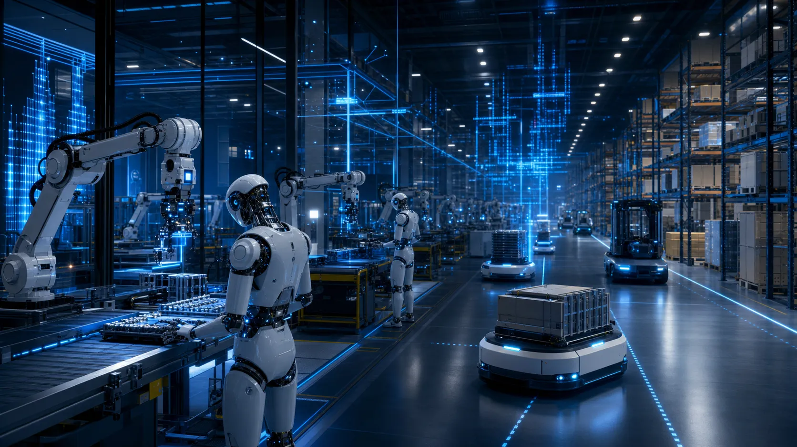

## 왜 지금 휴머노이드인가

수십 년 동안 "인간형 로봇"은 공상과학의 영역이었습니다. 그러나 2020년대에 들어 기계공학, 강화학습, 파운데이션 모델의 동시 발전으로 실제 산업 환경에 투입 가능한 수준의 휴머노이드 로봇이 등장하기 시작했습니다.

휴머노이드가 주목받는 이유는 명확합니다. 인간이 만든 대부분의 환경—공장, 창고, 사무실, 가정—은 인간의 신체 형태에 최적화되어 있습니다. 계단을 오르고, 문을 열고, 선반에서 물건을 꺼내고, 협소한 통로를 통과하는 데 인간형 신체가 유리합니다. 전용 장비를 바꾸지 않고도 기존 인프라에 배치할 수 있다는 경제적 이점이 있습니다.

## 주요 글로벌 플레이어

다음은 2026-10-23까지 확인한 기업 공식 발표입니다. 제품 공개, 시험 운영, 상업 계약, 생산 확대 목표를 구분합니다. 공개 영상은 무인 운영 시간이나 현장 전체 성공률의 증거가 아닙니다.

| 기업 | 공개된 플랫폼·방향 | 확인 범위 |
|---|---|---|
| Boston Dynamics | 전기형 Atlas 제품 버전 | 2026년 1월 제품 공개, Hyundai·Google DeepMind 초기 배치 계획 |
| Agility | Digit | GXO의 다년 RaaS 상업 배포 계약, 특정 물류 작업 |
| Figure | Figure 03·Helix 02 | 2026년 1월 전신 자율 동작 공개, 회사 시연 조건 |
| Tesla | Optimus | 공장·일상 작업을 지향하는 개발 프로젝트 |
| Unitree | H1·G1 등 | 연구·개발용 플랫폼, 모델별 센서·SDK 조건 확인 |
| 1X / Apptronik | NEO / Apollo | 가정 보조 / 제조·물류 지향, 제품별 공개 범위 확인 |

### Boston Dynamics Atlas

Boston Dynamics는 수십 년간 동적 로봇 운동(dynamic locomotion) 분야를 선도해 왔습니다. 기존 유압형 Atlas가 파쿠르·점프를 시연했고, 2024년 4월 전기형 연구 플랫폼을 공개했습니다. 2026년 1월에는 제품 버전 Atlas를 공개했습니다. 서로 다른 세대의 시연·사양을 합쳐 비교하지 않습니다. 현대차그룹의 계열사로서 자동차 제조 환경을 주요 배포 대상으로 하고 있습니다.

### Agility Robotics Digit

**Digit**는 양족 보행과 팔 조작을 결합한 물류 특화 휴머노이드입니다. Amazon의 시험과 별개로, GXO는 2024년 다년 RaaS 계약을 통해 실제 물류 운영에 Digit을 배치했습니다. 이 사례는 특정 토트 운반 작업의 상업 배포이며 모든 창고 과제에 대한 범용성을 뜻하지 않습니다.

### Tesla Optimus

Tesla는 자사 제조 공장에서 먼저 Optimus를 운용하며 데이터를 축적한다는 전략을 공개적으로 밝혔습니다. 자동차 제조 공정은 반복적이고 구조화된 환경이라 초기 배포에 유리합니다. 자동차 생산에서 쌓은 제조 규모와 비용 효율화 경험이 강점으로 언급됩니다.

### Unitree

중국 기업 Unitree는 상대적으로 저렴한 가격의 휴머노이드 플랫폼(H1, G1)을 연구자와 개발자를 대상으로 판매하고 있습니다. 고급 기술보다 접근성을 앞세워 빠르게 보급된 것이 특징입니다.

## NVIDIA의 역할

NVIDIA는 컴퓨팅 플랫폼·모델·시뮬레이션과 로봇 파트너의 참조 워크플로를 제공합니다. NVIDIA의 모델·개발 키트와 파트너 회사의 완성 로봇 제품을 구분합니다.

**GR00T(Generalist Robot 00 Technology)**: 휴머노이드를 위한 파운데이션 모델. 다양한 로봇 플랫폼에서 동작 생성과 과제 수행을 위한 공통 학습 기반 제공을 목표로 합니다. 여러 휴머노이드 기업들이 GR00T를 자사 로봇에 적용하는 파트너십을 발표했습니다.

**Jetson Thor**: 로봇 엣지 컴퓨팅을 위한 고성능 SoC(System-on-Chip). 대형 신경망 추론을 로봇 탑재 컴퓨터에서 실행하는 데 필요한 전력 효율을 갖추는 것을 목표로 합니다.

**Isaac 플랫폼**: 시뮬레이션(Isaac Sim), RL 훈련(Isaac Lab), 실물 배포(Isaac ROS)를 잇는 소프트웨어 스택. 휴머노이드 회사들이 대규모 시뮬레이션 학습에 활용합니다.

NVIDIA의 포지션은 "인공지능 시대의 플랫폼 기업"과 유사합니다. 여러 로봇 회사들이 NVIDIA 인프라 위에서 경쟁하는 구조입니다.

## 공통 기술 도전

모든 휴머노이드 기업이 직면한 공통 도전이 있습니다.

**이족 보행의 안정성**: 두 발로 서는 것 자체가 공학적으로 어렵습니다. 동적 환경(불균일 바닥, 충격)에서 실시간으로 균형을 잡는 것은 여전히 활발한 연구 영역입니다.

**손재주(dexterity)**: 다섯 손가락으로 다양한 물체를 조작하는 것은 이족 보행보다 더 어렵습니다. 유연한 조작은 물류·제조에서 핵심 역량이지만 미해결 문제가 많습니다.

**배터리 수명**: 수십 킬로그램의 금속 구조물을 움직이는 에너지 소비는 크고, 현재 배터리 기술로는 연속 작업 시간이 제한적입니다.

**비용**: 현재 휴머노이드 로봇의 가격대는 모델·용도에 따라 크게 다르며, 광범위한 산업 배포를 위해서는 대폭 낮아져야 합니다. 제조 규모화(scale-up)가 핵심입니다.

**신뢰성**: 실제 산업 환경에서 수천 시간의 연속 운용을 견디는 내구성과 유지보수 용이성.

## 전망

휴머노이드 로봇은 현재 실험적 파일럿 단계에서 초기 상용화 단계로 전환되는 시점에 있습니다. 모든 기업이 공통적으로 강조하는 것은 특정 반복 과제에서 먼저 가치를 증명하고, 점진적으로 범위를 넓혀가는 전략입니다. "범용 가정용 로봇"은 아직 먼 목표이지만, "구조화된 산업 환경의 특정 과제 자동화"는 일부 상업 배포 사례가 있습니다. 이를 넓은 범용성으로 확대하려면 고장 간격·사람 개입 빈도·처리량·안전 평가·총운영비를 장기간 측정해야 합니다.
